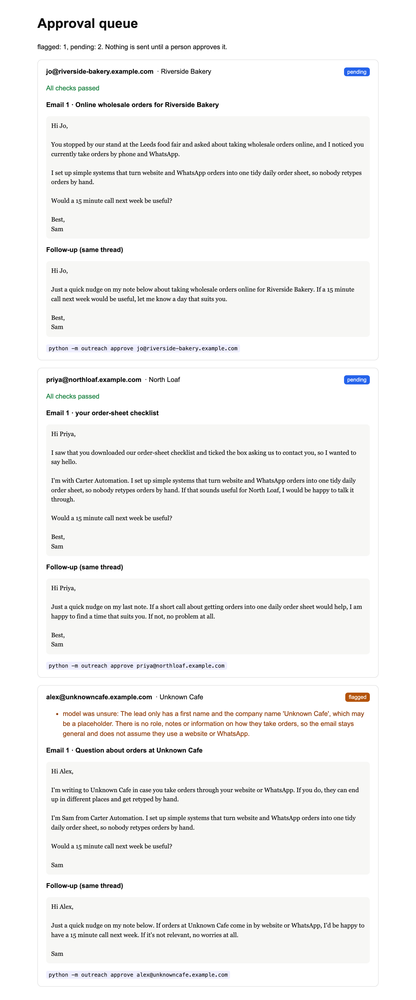
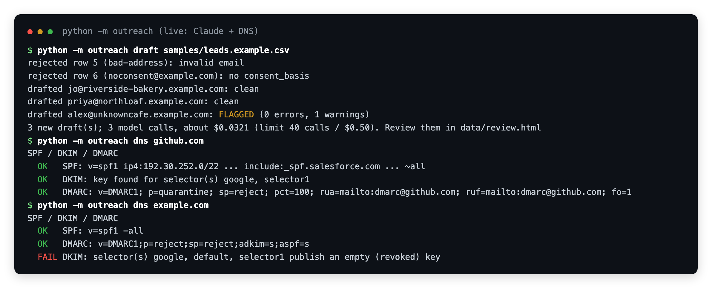
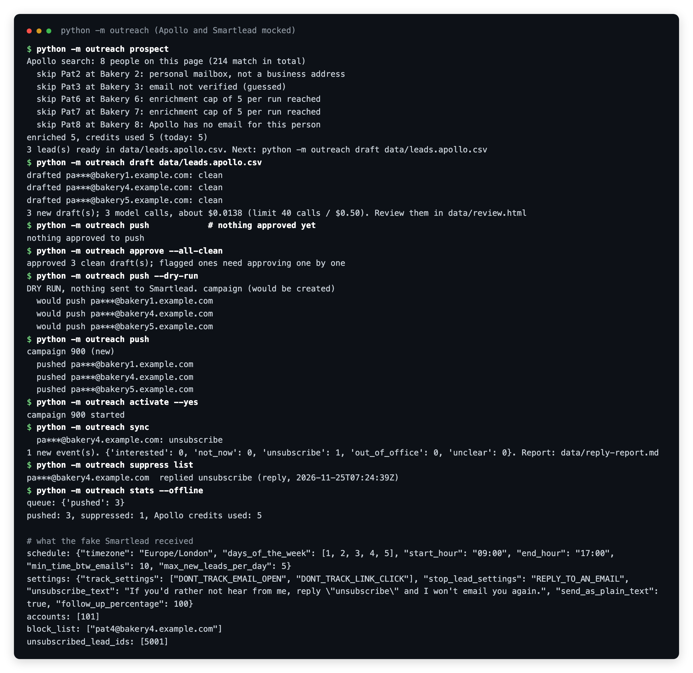

# AI Cold Outreach with Apollo + Smartlead (with a human approval step)

A careful cold-email pipeline in Python. [Apollo](https://www.apollo.io) finds the people (official API, search costs no credits), a capped enrichment step gets their verified work email, Claude writes a short personalised first email and one follow-up from the lead's own data, every draft is checked by code, a person approves it, and only then is the lead added to a [Smartlead](https://www.smartlead.ai) campaign with daily caps, a sending window and a fixed footer. Replies, unsubscribes and bounces come back by webhook (or polling), Claude sorts the replies, and anyone who asks to stop is suppressed locally, unsubscribed in the campaign and added to Smartlead's global block list.

> **Status, honestly:** the Claude drafting and the DNS checks were **run live** on 25 November 2026. The Apollo and Smartlead parts are **built and tested against mocks only, not proven against live accounts yet** (no API keys were available for this build; Smartlead's API is a paid-plan feature). Details in [Status](#status).



## How it works

```mermaid
flowchart LR
    A[Apollo people search<br/>0 credits, no emails] --> B{Pre-filter<br/>has email? enriched before?}
    B --> C[Enrich, capped per run<br/>1 credit each, work email only]
    C --> D{Drop: unverified, personal mailbox,<br/>suppressed address or domain,<br/>country not allowed, duplicate}
    D --> E[Claude drafts email 1 + follow-up<br/>strict JSON, cost guard]
    E --> F{Code checks<br/>facts, links, numbers, dashes,<br/>length, footer not rewritten}
    F --> Q[Approval queue<br/>queue.json + review.html]
    Q -->|a person approves| P[Push]
    P -->|suppression list, ledger,<br/>daily cap, account health| S[Smartlead campaign<br/>sequence, schedule, plain text,<br/>tracking off, stop on reply]
    S -->|webhook or polling| R[Replies, unsubscribes, bounces]
    R -->|keywords first, then Claude| L[Labels + report]
    R -->|stop requests and bounces| X[(Local suppression list)<br/>+ Smartlead unsubscribe<br/>+ global block list]
    X --> P
```

1. **Prospect (Apollo).** `POST /mixed_people/api_search` with the filters in `campaign.json` (titles, seniority, locations, company size, keywords). Search is free and returns no email addresses. People Apollo says have no email, and anyone enriched before, are skipped **before** any credit is spent. Then `POST /people/match` gets the work email for at most `max_enrich_per_run` people (personal emails and phone numbers are never requested). Every enrichment is logged, so you always know the credits used.
2. **Filter.** Only `verified` addresses, never personal mailbox domains (Gmail, Outlook and so on), never anyone on the suppression list (single addresses or whole domains), only `allowed_countries`, no duplicates. Each lead carries the campaign's `lawful_basis`. You can also start from your own CSV, which must have a `consent_basis` column.
3. **Draft (Claude).** `claude-sonnet-5-5` gets only the lead's own fields and the sender's offer and must answer in fixed JSON: subject, first email, follow-up, the facts it used (each copied from a named field) and an `unsure` flag. A thin row is flagged, not padded with guesses.
4. **Checks in code.** No link or number that isn't in the lead row or the offer; every "fact used" must really be in that field; no em or en dashes; no placeholders; word and subject limits; unknown names, spam wording and an unsure model are flagged. A failed draft gets one retry with the list of problems, then goes in the queue as flagged. The **footer** (name, company, postal address, unsubscribe line) is added by code, never written by the model, so it can't be dropped or reworded.
5. **Cost guard.** Each run has a ceiling on model calls and estimated dollars (`claude_max_calls`, `claude_max_usd`). The guard refuses a call that *could* cross the limit, and the run stops cleanly with what it has saved so far (the queue is saved after every lead).
6. **Approval.** Nothing reaches Smartlead until a person approves it. `approve --all-clean` for clean drafts; flagged drafts one at a time with `--accept-warnings`; drafts with errors can't be approved until edited. Approving re-runs the checks.
7. **Push (Smartlead).** Health checks first (accounts exist, SMTP and IMAP passing, warm-up on, cap within the mailbox limit). The campaign is created once: two-step sequence (follow-up as a reply in the same thread), schedule with `max_new_leads_per_day` = your `daily_cap`, plain text, open and click tracking off, stop on reply, your sending accounts. Each lead carries its approved text as custom fields. Before each lead: suppression list, local "pushed before" ledger, and the **local daily cap**. Smartlead is told not to ignore its block list, unsubscribes or duplicates. `push --dry-run` shows what would happen with no write calls.
8. **Activate.** `activate --yes` only; without `--yes` it tells you what would be sent and what is still unapproved.
9. **Replies.** `webhook` runs a small receiver (shared token in the URL, constant-time compare, body size limit, each delivery handled once even if Smartlead retries). `webhook --register https://your-host/smartlead?token=...` registers it on the campaign for `EMAIL_REPLY`, `LEAD_UNSUBSCRIBED` and `EMAIL_BOUNCE`. Without webhooks, `sync` polls each lead's message history. Stop wording ("unsubscribe", "remove me", ...) is caught by keywords first, so an opt-out never depends on the model; other replies are labelled `interested`, `not_now`, `out_of_office` or `unclear`. Opt-outs and bounces are suppressed locally first (so it works even if Smartlead is down), then unsubscribed in the campaign and added to the global block list.

## Quick start

```bash
python3 -m venv .venv && source .venv/bin/activate
pip install -r requirements.txt -r requirements-dev.txt
pytest -q                                   # 76 tests, no network, no keys
python scripts/demo_mocked.py live/mocked   # the whole flow against Apollo and Smartlead fakes
```

Keys come from environment variables or the macOS Keychain; nothing is written to disk:

```bash
security add-generic-password -s apollo-api-key -a "$USER" -w       # prompts for the key
security add-generic-password -s smartlead-api-key -a "$USER" -w
security add-generic-password -s anthropic-api-key -a "$USER" -w
export OUTREACH_WEBHOOK_TOKEN="$(python3 -c 'import secrets; print(secrets.token_urlsafe(24))')"
```

```bash
cp samples/campaign.example.json campaign.json   # sender, postal address, offer, lawful basis, filters, caps
python -m outreach dns yourdomain.com            # SPF, DKIM, DMARC
python -m outreach health                        # Smartlead accounts + DNS
python -m outreach prospect                      # Apollo -> data/leads.apollo.csv
python -m outreach draft data/leads.apollo.csv   # or your own CSV with consent_basis
python -m outreach review                        # list + data/review.html
python -m outreach approve --all-clean           # or: approve someone@example.com --accept-warnings
python -m outreach push --dry-run
python -m outreach push
python -m outreach activate --yes
python -m outreach webhook                       # or run `sync` every 15 to 30 minutes
python -m outreach stats
python -m outreach suppress add someone@example.com --reason "asked by phone"
python -m outreach teardown --yes                # pause and delete the campaign (suppression list kept)
```

Add `--mask` before the command to mask email addresses in the output.

## Status

**Run live on 25 November 2026:**

- **Claude drafting** on the three valid sample leads in `samples/` (real `claude-sonnet-5-5` calls, 3 calls, about $0.03 by the cost guard's estimate). The two leads with real notes came back clean and used only their own details; the thin "Unknown Cafe" row was **flagged** because the model said it had nothing to go on, instead of inventing something. The CSV loader rejected a bad address and a row with no consent basis. The review page above is that real output.
- **DNS checks** against public domains: github.com passed SPF, DKIM and DMARC; example.com was correctly failed on DKIM because it publishes an empty (revoked) key. That live run caught a real bug (an empty key had been counted as present), now fixed and covered by a test.



**Built and tested with mocks only, not proven live:**

- **Apollo** search and enrichment: no Apollo key was available. The client follows Apollo's current API docs (`x-api-key` header, `/mixed_people/api_search`, `/people/match`) and is tested with mocked HTTP, including retries, plan-limit errors and the enrichment cap. Apollo's free plan includes API access with search limits (50 a minute, 600 a day) but asks for a work email at sign-up.
- **Smartlead** campaign, leads, schedule, settings, activation, webhooks and reply polling: no Smartlead key was available, and Smartlead's pricing lists API and webhook access from the Pro plan (about $94 a month). Smartlead's own docs disagree on a few details (status value `START` vs `ACTIVE`, two webhook routes), so every path is in one table in `outreach/smartlead.py` and activation tries both values. Until it is run against a real account, treat the Smartlead side as unverified.
- The full flow (prospect, draft, approve, push, activate, sync, unsubscribe everywhere) runs end to end against in-memory fakes in `tests/test_cli.py` and `scripts/demo_mocked.py`:



**Not proven at all:** real sending, deliverability, warm-up, real reply webhooks, or volume.

## Compliance and deliverability

Read [docs/COMPLIANCE.md](docs/COMPLIANCE.md) (CAN-SPAM, UK PECR and GDPR, UAE PDPL and TDRA rules, Apollo, Smartlead and Gmail terms, and what the code enforces) and [docs/DELIVERABILITY.md](docs/DELIVERABILITY.md) (separate sending domain, SPF/DKIM/DMARC, warm-up, caps, list hygiene) before using this on real people. In short: business addresses only, a recorded lawful basis, sender and postal address in every email, opt-outs honoured everywhere at once, low volume, no scraping, official APIs only.

## Limitations

- One campaign per data folder; run separate campaigns from separate `--data-dir` folders.
- The checks catch invented specifics (names, numbers, links, facts); they can't judge tone or fit. That is what the approval step is for.
- The Smartlead lead id is only known after listing the campaign's leads. A stop request that arrives before that is suppressed locally and block-listed straight away, and the campaign-level unsubscribe is finished on the next `sync` (which also retries any block-list call that failed).
- The cost guard estimates spend from token counts and list prices in `outreach/llm.py`; check Anthropic's pricing page if prices change.
- The SPF check does not count DNS lookups (the 10-lookup limit).

## Project layout

```
outreach/
  config.py     campaign settings and their checks (lawful basis, postal address, caps)
  leads.py      CSV loading, the Lead record, personal-mailbox domains
  apollo.py     Apollo API client (search, enrichment)
  prospect.py   search -> pre-filter -> capped enrichment -> filters
  llm.py        model provider interface, Claude provider, cost guard
  drafting.py   prompt, strict JSON, one retry with the failed checks
  validate.py   every rule a draft must pass
  approval.py   the queue and the review page
  smartlead.py  Smartlead API client (endpoint table, batching, START/ACTIVE)
  http.py       shared retries (429/5xx, Retry-After) and key redaction
  health.py     account, warm-up, cap and SPF/DKIM/DMARC checks
  push.py       campaign build, footer, daily cap, suppression and duplicate guards, dry run
  replies.py    webhook events, polling, keyword + Claude labels, stop everywhere, report
  webhook.py    small token-protected receiver (standard library)
  store.py      SQLite: suppression, push ledger, replies, events, Apollo credit log
  cli.py        python -m outreach ...
docs/           compliance and deliverability notes
samples/        example campaign settings and leads (example.com addresses)
scripts/        mocked end-to-end demo, README image rendering
tests/          76 tests, Apollo, Smartlead and Claude mocked
```

## Tests

`pytest -q` runs 76 tests with no network: settings validation; the CSV rules; every draft check; the drafting retry and the cost guard (by calls and by dollars); the Claude provider (text and usage, cut-off and refusal, SDK errors wrapped); both API clients with mocked HTTP (auth header vs query key, the key never in errors or `repr`, 429 with Retry-After, 5xx retries, no retry on 4xx, plan-limit detection, pagination, lead batching, the START/ACTIVE fallback, webhook registration); prospecting (field mapping, every filter, the enrichment cap, never enriching twice, stopping on a plan limit); push (nothing without approval, suppressed addresses and domains never reach the API, local daily cap, dry run makes no calls, failures stay retryable); health and DNS (including revoked DKIM keys); replies (keyword opt-out without the model, duplicate deliveries, bounces, Smartlead down); the webhook server over real HTTP; and the whole CLI flow end to end. GitHub Actions runs `ruff` and the tests on Python 3.9 and 3.12.

## Stack

Python 3.9+ · Apollo API · Smartlead API · Anthropic Claude (`claude-sonnet-5-5`) · SQLite · dnspython · pytest + responses · ruff · GitHub Actions

---
Part of a small portfolio of tested automation and AI builds; see [ParishSynthMind](https://github.com/ParishSynthMind) for the others. The Instantly version of the same idea, tested live on an Instantly trial, is [ai-cold-outreach-instantly](https://github.com/ParishSynthMind/ai-cold-outreach-instantly).
